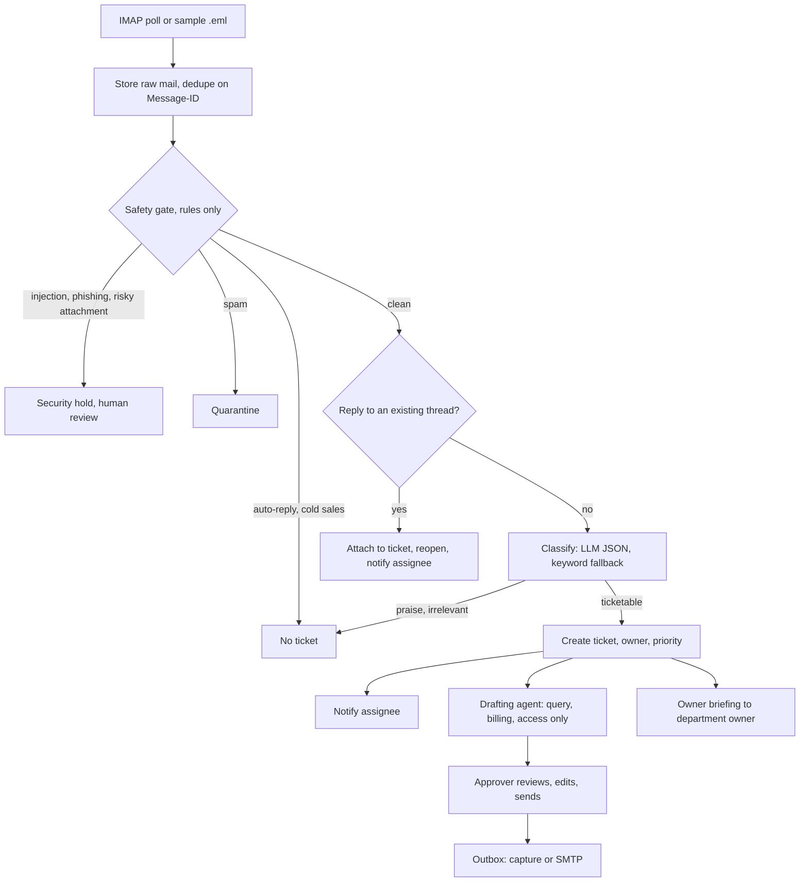
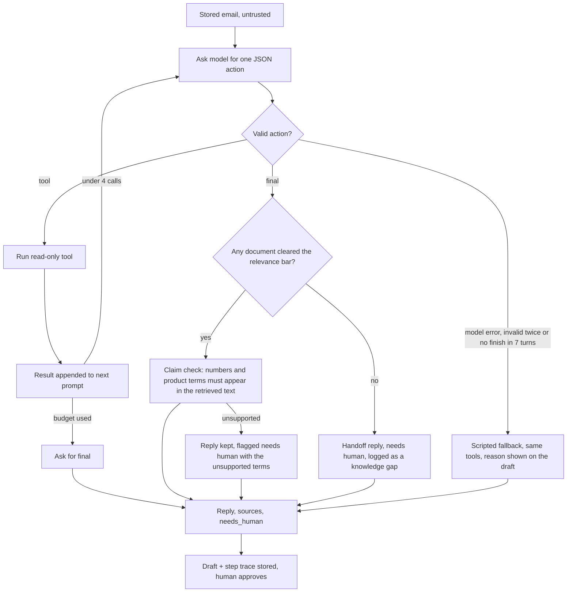

# FlowSync Triage

An AI agent for a support inbox. It reads incoming mail, screens it for spam, phishing and prompt injection, works out what each mail is about, opens tickets with an owner and priority, and drafts replies from a knowledge base. A person reviews and approves every reply before anything is sent.

I built it as a working example of an agentic workflow with a human in the loop: the model is used where judgement helps (classifying, drafting) and plain rules and code are used where predictability matters (safety checks, routing, sending).

**What is real and what is made up.** The app (safety gate, classifier, pipeline, drafting agent, retrieval, dashboard) is real software. **FlowSync**, its customers, plans, connectors and docs are fictional. They exist so the agent has a product to support, and the docs claim no certifications.

Stack: Java 21 and Spring Boot, Angular, Postgres. The default model is Groq (`openai/gpt-oss-20b`) and the provider is swappable.

Demo recording (about 4 minutes, captions on screen): [docs/demo.mp4](docs/demo.mp4)

> **About the recording.** It is a real run of this app (backend, dashboard, database) with the bundled sample mailbox. The model responses in it come from a scripted local provider, not a live Groq or OpenAI call, so the model name on the Stats screen is only a label and the recording says nothing about real reply quality. Replies are captured in the outbox and nothing is emailed. Run it with your own key to see real model output (see "Turning on the real model").

## What it does

- **Reads mail** from an IMAP inbox (a dedicated test Gmail) or from the bundled sample mailbox. Each mail is stored once; duplicates are dropped on Message-ID.
- **Safety gate (rules only, before any model).** Prompt injection, phishing links and risky attachments go to a security hold. Spam goes to quarantine. Auto-replies and cold sales pitches are logged with no ticket.
- **Thread matching.** A reply to a mail that already has a ticket is attached to it (In-Reply-To, References, or a matching "Re:" subject from the same sender). The ticket is reopened and the assignee is notified.
- **Classification.** The model returns JSON that is validated: QUERY, BUG, WRONG_BEHAVIOUR, ENHANCEMENT, BILLING, ACCOUNT_ACCESS, OUTAGE, or PRAISE, SPAM, SALES, IRRELEVANT (no ticket). If the model is off, slow or returns something invalid, keyword rules take over and the ticket is flagged for review.
- **Tickets.** Category, priority (P1 to P4), owner from a routing table (never taken from the email), notification trail, pipeline trace with per-stage latency.
- **Drafted replies.** For query, billing and access mail, the model runs a short loop with read-only tools (`lookup_customer`, `search_knowledge`, `ticket_history`, `open_incidents`), then writes the reply. Every step is shown on the ticket. If no document answers the question, the draft is a short handoff reply flagged for a person.
- **Claim check.** Numbers and product terms in a draft that appear in neither the retrieved text nor the customer's mail flag the draft for human review. The text is kept, not edited.
- **Human approval.** Only an approver can send. Edits are allowed. Every approval is audited with actor, draft hash and recipient, and a draft can be sent once.
- **Regenerate draft.** Rejects the open draft and asks the agent again; the old draft stays as history.
- **Review queue.** Held, quarantined and no-ticket mail stay visible with the reason. An approver can release any of them as a ticket (flagged for review) or dismiss it. Mail the model calls unrelated is kept there with a "possibly unrelated" reason, never silently dropped.
- **Owner briefing.** When a ticket is created, the owning department gets a short brief with the customer's plan, SLA and the escalation steps.
- **Stats.** Model and send mode, knowledge base size, mail by outcome, gate verdicts, tickets by category and priority, and stage latency (p50 and p95) measured on the running instance.
- **Live dashboard.** Updates over server-sent events.

## How a mail flows

```
IMAP inbox / sample .eml files
        |  store raw mail (dedupe on Message-ID)            <- the emails table is the durable queue
        v
worker (virtual thread, one lock per thread)
   1. Safety gate (rules)      injection / phishing / risky attachment -> SECURITY HOLD
                               spam -> QUARANTINE;  auto-reply / cold sales -> NO TICKET
   2. Thread match             reply to a ticketed thread -> attach, reopen, notify
   3. Classify (model, JSON)   keyword fallback if the model is off or invalid (ticket flagged)
   4. Ticket, owner, priority, notifications
   5. Draft (query, billing, access): tools -> reply -> claim check  (or handoff if no doc answers)
   6. Owner briefing to the department owner
        |
        v
Dashboard: a person edits, approves, rejects or regenerates. Approve -> outbox (capture) or SMTP (live)
```

### Pipeline



### Drafting agent loop



Tools: `search_knowledge` (vector search over docs, client profiles, process notes), `lookup_customer` (bound to the stored sender), `ticket_history`, `open_incidents`. All read-only.

### Modules

| Package | Role |
|---|---|
| `ingest` | ImapPoller, EmailParser, SampleLoader, Assigner |
| `gate` | SafetyGate: rules for injection, phishing, spam, sales, auto-replies, risky attachments |
| `llm` | One OpenAI-compatible client, Classifier, keyword HeuristicClassifier |
| `agent` | DraftAgent, AgentTools, KnowledgeBase, Embedder, OwnerAlert, Departments |
| `pipeline` | Pipeline orchestration, Evaluator |
| `notify` / `store` / `web` | Notifier and Outbox, JDBC store with Flyway, REST API with auth and SSE |

## Design choices

- **The gate runs before the model.** Obvious attacks never reach the LLM, which saves cost and shrinks the injection surface. Mail text is also treated as untrusted data in prompts, validated on the way out and escaped in every sink.
- **Agentic only where it helps.** The model picks tools only for drafting, with read-only tools and a step cap. Classification fallback, safety and routing are fixed steps.
- **Replies are never sent automatically.** The default send mode is `capture` (stored in the outbox table). `live` sends over SMTP.
- **One OpenAI-compatible client.** Groq, OpenAI and Ollama differ only by base URL, model and key. With no key the keyword fallback runs and the app still works.
- **Workers are virtual threads and the queue is a table.** The model call dominates latency. This has not been load-tested.

## Knowledge base and retrieval

`backend/src/main/resources/kb/` holds 25 fictional product docs, 7 client profiles and 5 escalation notes. Product docs are split by `## ` section so one chunk answers one question, and each carries `plan`, `tags` and `reviewed` front matter that is searched too.

Search is hybrid: BM25 keyword ranking and vector similarity are merged with reciprocal rank fusion. A chunk scoring under the relevance bar (`KnowledgeBase.MIN_RELEVANCE`, 0.30) is not returned, so "no document answers this" is a real outcome and leads to the handoff reply. The default embedder is a local feature-hashing one (no model, no network), so it matches words, not meaning; the keyword half is what carries most queries. Groq has no embeddings endpoint. `EMBED_PROVIDER` and `EMBED_MODEL` can point at another embedder. With `PGVECTOR=true`, vectors are also written to a pgvector column; search itself runs in memory.

I picked the bar and weights on 43 questions I wrote against the docs (`backend/src/test/resources/kb-eval.tsv`, run by `KbEvalTest`). Against whole-file vectors, hit@1 went 24 to 31 and hit@3 34 to 39 of 39 answerable questions, and 4 of 4 unanswerable questions were handed off instead of 2 of 4. I wrote both the docs and the questions, and added one doc tag after a miss, so this is a regression check, not a benchmark.

## Run it

You need Docker Desktop (Windows, PowerShell 5.1+). On the first run `run.ps1` creates `.env` from `.env.example`, which means: model off, replies captured, sample mailbox only.

```powershell
git pull
.\run.ps1
```

It builds and starts Postgres, the backend and the dashboard, then opens http://localhost:4200. `.\run.ps1 -Down` stops it and `.\run.ps1 -Logs` follows the backend log. On any OS: `docker compose up --build`.

Without Docker (quick look, in-memory H2, data is lost on restart):

```bash
cd backend && SPRING_PROFILES_ACTIVE=h2 mvn spring-boot:run
cd frontend && npm install && npm start      # http://localhost:4200, proxies /api to :8080
```

### Using the dashboard

1. Sign in as `agent` or `approver`. The demo passwords come from `.env` (defaults `agent123` and `approver123`; change them if anyone else can reach the app).
2. Click **Load sample mailbox**, or enable IMAP (below) and send a mail to the test inbox. Tickets appear live.
3. Open a ticket: read the classification, the draft, the **Agent trace**, the conversation, the owner briefing and the pipeline trace.
4. As an approver, edit and **Approve & send**, or **Reject**, or **Regenerate draft**. As an agent those buttons are disabled.
5. **Review queue** shows held, quarantined and no-ticket mail with reasons. Approvers can **Release as ticket** or **Dismiss**.
6. **Stats** shows the running totals and latency.

### Turning on the real model

Set these in `.env`, then restart (`.\run.ps1`):

```
LLM_PROVIDER=groq
LLM_API_KEY=<your key>
```

Then run `.\scripts\eval-live.ps1`: it runs the labelled sample sets against the running app, prints accuracy and every miss, and shows whether each answer came from the model or the keyword fallback. The free Groq tier has a tokens-per-minute limit, so send test mails one at a time and avoid running `eval-live` twice back to back. The draft's "by" label tells you whether the model or the scripted fallback wrote it, and Stats shows the last model error.

### Reading a test mailbox

Set `IMAP_ENABLED=true`, `IMAP_USER` and `IMAP_PASSWORD` (a Gmail app password) for a **dedicated test inbox**. The poller reads unread mail and marks it read, so never point it at a real inbox. `IMAP_MAX_AGE_DAYS` skips older unread mail, and a mail that cannot be parsed is skipped until restart so it cannot block the ones behind it.

## Configuration (`.env`)

| Setting | Purpose |
|---|---|
| `LLM_PROVIDER` `LLM_API_KEY` `LLM_MODEL` `LLM_BASE_URL` | `groq`, `openai`, `ollama` or `none` (keyword fallback). Check the provider's current free-tier limits yourself. |
| `LLM_MIN_INTERVAL_MS` | Spacing between model calls. Default 2500 for Groq, 0 otherwise. |
| `IMAP_ENABLED` `IMAP_HOST` `IMAP_USER` `IMAP_PASSWORD` `IMAP_MAX_AGE_DAYS` | Test inbox polling. |
| `SEND_MODE` `SEND_FROM` `SMTP_*` | `capture` (default, nothing is emailed) or `live` (SMTP). Live sending is optional. |
| `SLACK_WEBHOOK_URL` | Optional. Without it, notifications are recorded in the dashboard only. |
| `DEPARTMENTS` | Owner email per department for owner briefings. |
| `AGENT_PASSWORD` `APPROVER_PASSWORD` `DB_PASSWORD` | Demo logins and database password. |
| `EMBED_PROVIDER` `EMBED_MODEL` `EMBED_BASE_URL` `EMBED_API_KEY` `PGVECTOR` | Knowledge base embeddings. Default is the built-in local hash embedder. |

Secrets live in `.env`, which is git-ignored. `.env.example` has no real values.

## Tests

```bash
cd backend && mvn test
cd frontend && npx ng build
```

The backend tests cover the gate, classifier, model client errors and pacing, native tool calls, the grounding check, retrieval evaluation, a draft regression set, regenerate, the full sample-mailbox pipeline, and the API with roles and approval. The draft regression set (`DraftRegressionTest`) uses a synthetic provider that speaks the Groq format. It checks how the app handles replies (retrieval, handoff, claim check, review flag, gap log, regenerate, unrelated mail), not how good a real model's replies are. CI runs both commands on every push (`.github/workflows/ci.yml`).

## Known limits

- **Measured on Groq** (`openai/gpt-oss-20b`): classification on the basic set scored 1.0 disposition and 1.0 category (16 mails); on the messy set 1.0 disposition and 0.92 category (28 mails; 18 answered by the model, 5 by the keyword fallback, 5 by the gate). Misses: `m13` (SALES vs SPAM) and `m25` (ENHANCEMENT vs QUERY). I left both labels as they are: they are judgment calls, and tuning to two samples would only overfit. These sets are small and written by me, so they are regression checks, not accuracy claims.
- **Reply quality is not measured.** I have read real model drafts and caught one that said scripts could not start a sync (it can; the prompt and docs were tightened). There is no score for reply accuracy.
- **The claim check is a heuristic.** It catches invented numbers and product terms. It cannot tell that a sentence built from words that do appear is wrong.
- **Follow-ups are limited.** A reply to a ticketed thread is attached and reopens the ticket, but it does not re-classify, change priority or write a new draft. **Regenerate** works from the first mail on the ticket only.
- **Rate limits.** Model calls are spaced 2.5 s apart on Groq and `Retry-After` is honoured. That reduces bursts but does not guarantee the free tier's 8,000 tokens-per-minute limit. If a call fails, the scripted fallback writes the draft and says why on the draft.
- **Retrieval** runs on fictional docs and my own questions. Keyword plus hash vectors match words, not meaning.
- **Not verified:** long-running IMAP polling, a real pgvector database, and live SMTP sending. CI builds and tests the code, not the Docker images. Capture mode is the supported path.
- **Security.** Sessions are in memory and auth is demo-grade (seeded users). The regex gate is not a security boundary against a determined attacker; read-only tools, the claim check and human approval limit the damage if injection reaches the model.
- **Not built:** WhatsApp notifications, Gmail push (IMAP polling only), load testing.
