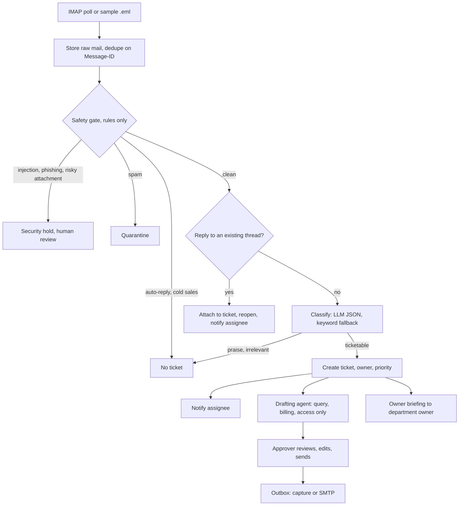
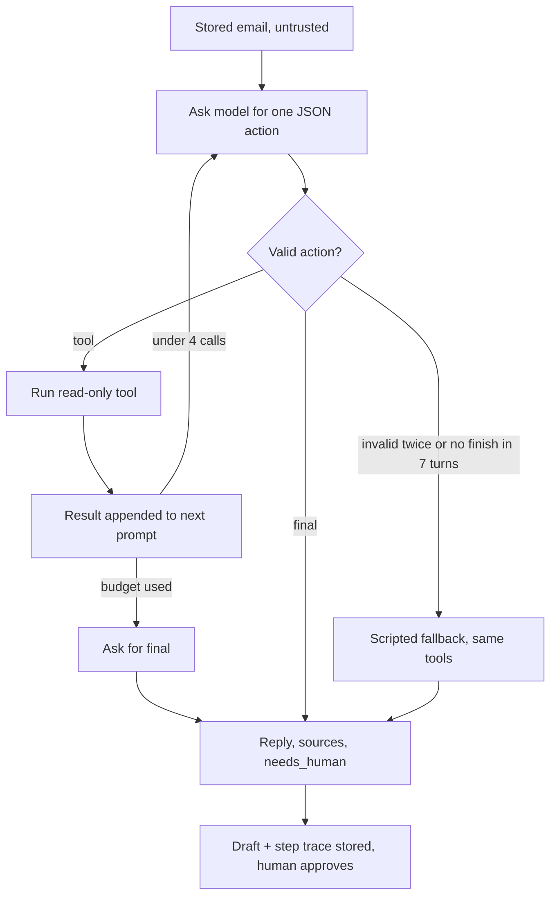

# FlowSync Triage

AI email triage agent. It watches one support inbox, screens every mail for spam, phishing and prompt injection,
classifies what is left, turns it into tickets, notifies the owner, and drafts replies that a human approves with one click.

The fictional company is **FlowSync**, a B2B SaaS that syncs records between tools customers already use
(Salesforce/HubSpot to databases and sheets). The sample mailbox is written for that product.

> Status: complete demo build on `develop`. Works end to end on the bundled sample mailbox with no API key. Not yet verified: the Docker build, a real Groq run, real IMAP/SMTP and a real pgvector database (see Known limits).


Demo video (about 1 minute, sample data): [docs/demo.mp4](docs/demo.mp4)

## How it works

```
IMAP inbox / sample .eml files
        |  store raw mail (dedupe on Message-ID)           <- emails table is the durable queue
        v
virtual-thread worker (per-thread lock)
   1. Safety gate (rules, no LLM)   prompt injection / phishing / risky attachment -> SECURITY HOLD
                                    spam -> QUARANTINE;  auto-reply / cold sales -> NO TICKET
   2. Thread match                  In-Reply-To / References / subject -> attach to existing ticket
   3. Classify (LLM, JSON, validated) QUERY BUG WRONG_BEHAVIOUR ENHANCEMENT BILLING ACCOUNT_ACCESS OUTAGE | PRAISE SPAM SALES IRRELEVANT
        falls back to keyword rules when the LLM is off, slow or invalid (ticket is flagged "needs review")
   4. Ticket + owner + priority + notifications (Slack webhook, email captured)
   5. Drafting agent (query, billing, access mail): the LLM picks read-only tools in a bounded loop (search_knowledge, lookup_customer,
      ticket_history, open_incidents), then writes the reply. Scripted run of the same tools when no LLM. Sent only after an APPROVER clicks approve
   6. Owner briefing: an email to the owning department's owner with the ticket, customer plan/SLA and the department's escalation process
        |
        v
Angular dashboard (live updates over SSE), audit log, pipeline trace per mail
```

Key choices:

- **Java 21 / Spring Boot, Angular, Postgres.** Chosen for experience and for typed concurrency; the LLM call dominates latency, so workers are virtual threads and the pipeline is queue-based.
- **One OpenAI-compatible LLM client.** Groq (default, free tier), OpenAI and Ollama differ only by base URL, model and key. No key means the keyword fallback runs, and the app still works.
- **The gate runs before the model.** Hostile or junk mail never reaches the LLM, which saves cost and removes the injection surface for obvious attacks. Email text is also treated as untrusted data in prompts, validated on the way out, and escaped in every sink.
- **Replies are never auto-sent.** Default send mode is `capture` (stored in the outbox table). `live` sends via SMTP from the dedicated test mailbox.
- **Roles.** `agent` works tickets; `approver` can send replies and release held mail. Every approval is audited with actor, draft hash and recipient.

## Diagrams

### Pipeline



### Drafting agent loop



Tools: `search_knowledge` (vector search over docs, client profiles, process notes), `lookup_customer` (bound to the stored sender), `ticket_history`, `open_incidents`. All read-only.

### Modules

| Package | Role |
|---|---|
| `ingest` | ImapPoller, EmailParser, SampleLoader, Assigner |
| `gate` | SafetyGate: regex rules for injection, phishing, spam, sales, auto-replies, risky attachments |
| `llm` | One OpenAI-compatible client, Classifier, keyword HeuristicClassifier |
| `agent` | DraftAgent, AgentTools, KnowledgeBase, Embedder, OwnerAlert, Departments |
| `pipeline` | Pipeline orchestration, Evaluator |
| `notify` / `store` / `web` | Notifier and Outbox, JDBC store with Flyway, REST API with auth and SSE |

### Screens

| Agent trace | Owner briefing |
|---|---|
|  |  |


## The agent layer

- **Knowledge base (vector store).** Product docs, client profiles and internal escalation processes live in `backend/src/main/resources/kb/`.
  Each file is embedded once and stored in the `kb_chunks` table with the embedder id and a content hash (restarts re-embed only what changed).
  Search is cosine similarity in memory. With `PGVECTOR=true` (the Docker default) the vectors are also stored in a pgvector column and the database does the search; any pgvector error falls back to the in-memory search. Not yet run against a real pgvector database.
  The default embedder is a local feature-hashing one (no model, no network, no RAM). It matches words, not meaning; set `EMBED_PROVIDER=ollama`
  and `EMBED_MODEL=nomic-embed-text` (or `openai`) for model embeddings.
- **Drafting agent.** One JSON action per turn: call a tool or finish. At most 4 tool calls, invalid output twice or no finish falls back to the scripted run.
  Every tool is read-only, the customer is always the stored sender (model arguments cannot redirect the lookup), and the email is treated as untrusted data.
  The dashboard shows the full tool trace under each draft.
- **Owner briefing.** After a ticket is created, the department owner (`DEPARTMENTS` in `.env`, never taken from the email) gets a short brief. One per ticket.
  Goes through the same switch as replies: `SEND_MODE=capture` stores it (shown on the ticket), `live` sends it over SMTP.

## Checking the real model

Set `LLM_PROVIDER=groq` and `LLM_API_KEY=...` in `.env`, run `.\run.ps1`, then `.\scripts\eval-live.ps1`. It prints accuracy for the basic and messy sets and every miss, and shows whether each answer came from the model or the keyword fallback. Load the sample mailbox and open a query ticket to read the agent trace. Do this before trusting the model path: it has only been tested with a scripted fake model.

## Run it (Windows, Docker Desktop)

```powershell
.\run.ps1
```

That copies `.env.example` to `.env` on first run, builds and starts Postgres, backend and dashboard, then opens http://localhost:4200.
Sign in as `agent` or `approver` (demo passwords are in `.env`). The sample mailbox loads on start, or use **Load sample mailbox**.
`.\run.ps1 -Down` stops it, `.\run.ps1 -Logs` follows backend logs. Same thing on any OS: `docker compose up --build`.

### Without Docker (quick look)

```bash
cd backend && SPRING_PROFILES_ACTIVE=h2 mvn spring-boot:run      # in-memory H2, data lost on restart
cd frontend && npm install && npm start                          # http://localhost:4200, proxies /api to :8080
```

## Configuration (`.env`)

| Setting | Purpose |
|---|---|
| `LLM_PROVIDER` `LLM_API_KEY` `LLM_MODEL` `LLM_BASE_URL` | `groq`, `openai`, `ollama` or `none` (keyword fallback). Check the provider's current free-tier limits yourself. |
| `IMAP_ENABLED` `IMAP_USER` `IMAP_PASSWORD` | Poll a **dedicated test Gmail** (app password). Do not point this at a real inbox. |
| `SEND_MODE` `SEND_FROM` `SMTP_*` | `capture` (default) or `live`. |
| `SLACK_WEBHOOK_URL` | Optional. Without it, notifications are recorded in the dashboard only. |
| `AGENT_PASSWORD` `APPROVER_PASSWORD` | Demo logins. Change them if the app is reachable by anyone else. |

Secrets live in `.env` (git-ignored). `.env.example` has no real values.

## Tests

```bash
cd backend && mvn test        # gate and classifier unit tests, full sample-mailbox pipeline test, API/roles/approval test
cd frontend && npx ng build
```

CI runs both on every push (`.github/workflows/ci.yml`).

## Known limits (honest list)

- The keyword fallback is deliberately simple; its accuracy has not been measured. LLM accuracy and latency are also unmeasured until the eval run is done.
- The knowledge base is small and hand-written (6 docs, 7 client profiles, 5 process notes); retrieval quality with the hashing embedder is word-overlap, not semantic. Client data is fictional.
- Sessions are in memory and auth is demo-grade (seeded users). Production would use SSO.
- Not run yet: the Docker build, a real Groq run (the agent loop is tested only with a scripted fake model), real IMAP/SMTP, a real pgvector database. `scripts/eval-live.ps1` measures the real model once a key is in `.env`.
- Eval sets: 16 basic and 28 messy labelled mails. On the keyword fallback the messy set scores 0.89 disposition and 0.68 category. They are small and author-written: regression checks, not accuracy claims.
- The regex gate is not a security boundary against a determined attacker. Read-only tools and human approval limit the damage if injection reaches the model.
- Not built: WhatsApp notifications, Gmail push (IMAP polling only), load numbers. Demo logins are `agent123` and `approver123` by default: change them for anything shared.
